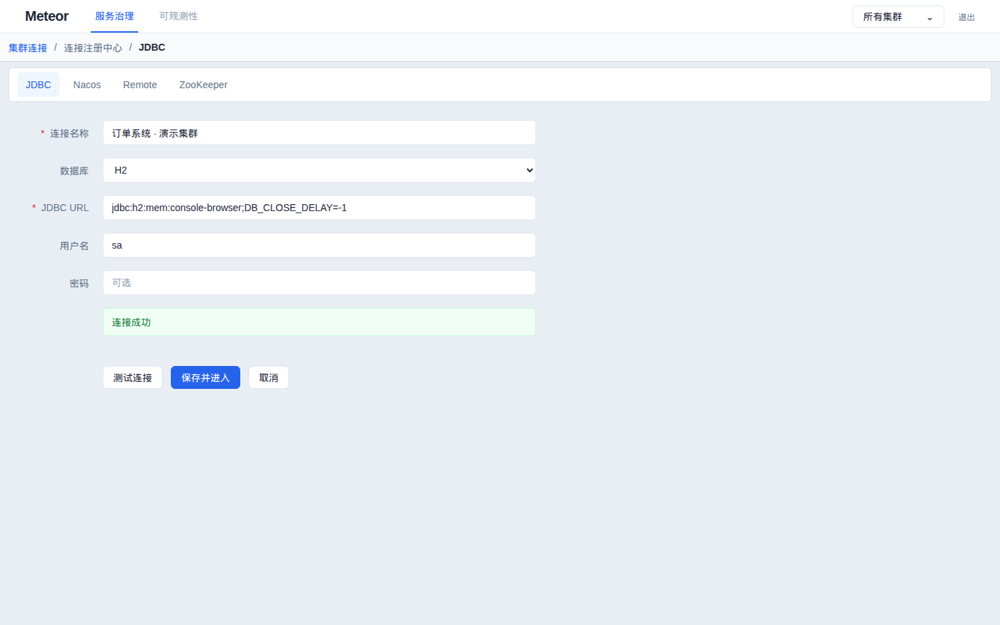
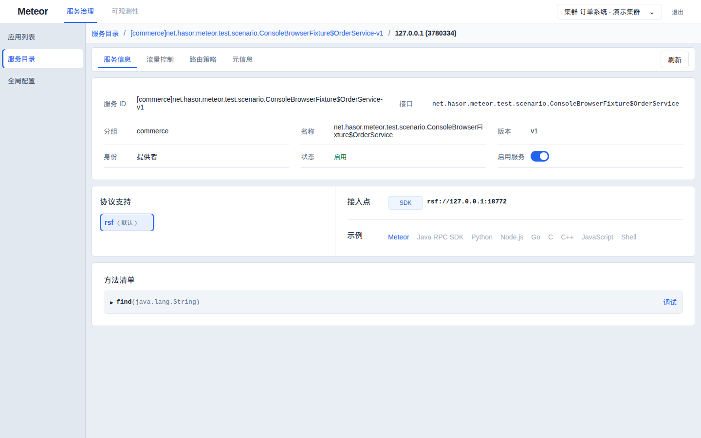
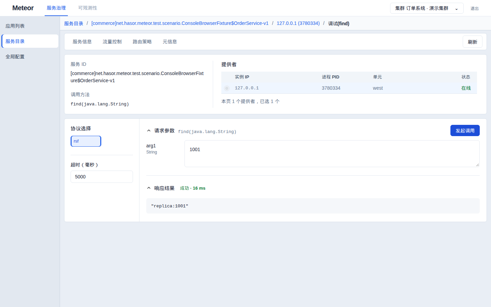

# Web 模式

通过浏览器查看应用和服务、调试调用并修改治理配置。

## 启动

创建 `meteor.properties`，按[运行准备](about.md#运行准备)中的命令启动：

```properties
hasor.boot.web.connectors.http.host=127.0.0.1
hasor.boot.web.connectors.http.port=8080
meteor.data.directory=./data/console
meteor.web.auth.enabled=true
meteor.web.auth.account=admin:replace-with-your-password
```

访问 `http://127.0.0.1:8080`，使用配置的账号和密码登录。需要从其他机器访问时，将监听地址改为服务器网卡地址或 `0.0.0.0`。

登录页和控制台右上角都可以切换简体中文和 English，浏览器会记住选择。控制台从后端加载语言包，后续请求的错误和提示也使用所选语言。

自定义客户端可通过 `Accept-Language: zh-CN` 或 `Accept-Language: en-US` 选择语言。匿名 `GET /api/i18n` 返回 `locale` 和 `messages`，缺省语言为简体中文。

## 连接集群

在顶部集群入口新建连接，选择 JDBC、Nacos 或 ZooKeeper，填写地址和认证信息，测试成功后保存。参数应与业务实例使用的注册中心一致；连接其他 Console 时选择 Remote，见[异地管理](remote.md)。

顶部集群入口也可选择“直连实例”，不经过注册中心直接连接业务实例。

连接保存到 `meteor.data.directory/clusters.json`，重启后仍可使用。Console 需要能访问注册中心；查看实例详情和调试调用还需能访问业务实例的相应接入点。



## 查看服务

“应用列表”按应用查看实例，“服务目录”按服务查找提供者和消费者。打开服务后，可查看方法、协议接入地址，获取接口文件和不同语言的调用示例。



## 调试调用

在方法列表点击“调试”，选择目标实例和协议、填写参数后发起调用。支持单目标或多目标调用，并展示每个目标的结果和耗时。



## 服务治理

“路由策略”“流量控制”和“元信息”用于修改当前服务的配置，“全局配置”用于设置集群级配置。规则效果和写法见[治理能力](../governance/capabilities/about.md)。

从服务目录进入时操作整个服务，从实例下进入时操作该实例的服务；保存前核对当前对象，应用同步后生效。

### 修改状态

关闭服务的启用开关可停用服务，实例阻断会影响该实例的网络业务调用。需要恢复时，在原位置启用服务或解除阻断，效果见[服务停用](../governance/enabled.md)。

### 修改元信息

在“元信息”中按键添加、修改或删除属性，用于记录负责人、环境等信息，详见[元信息](../governance/metadata.md)。

## 配置参数

| 配置 | 默认值 | 说明 |
| --- | --- | --- |
| `meteor.web.enabled` | `true` | 启动 Web 容器 |
| `hasor.boot.web.connectors.http.host` | `127.0.0.1` | HTTP 监听地址 |
| `hasor.boot.web.connectors.http.port` | `8080` | HTTP 监听端口 |
| `meteor.web.auth.enabled` | `false` | 是否启用登录 |
| `meteor.web.auth.account` | 未设置 | 登录账号和密码，格式为 `账号:密码` |
| `meteor.web.session.secure-cookie` | `false` | HTTPS 部署时可设为 `true` |
| `meteor.data.directory` | `~/.meteor/data` | 保存集群连接和运行数据 |
| `meteor.commands.context.ttl-millis` | `300000` | 管理连接缓存时间，单位为毫秒 |
| `meteor.client.unit` | `default` | Console 出站管理上下文所属单元 |

Web 模式也可启用 Telnet，在当前配置文件中加入 [telnet 配置](headless.md#连接配置)并设置 `meteor.telnet.enabled=true`。命令用法见[使用 Telnet](../governance/telnet/about.md)。
