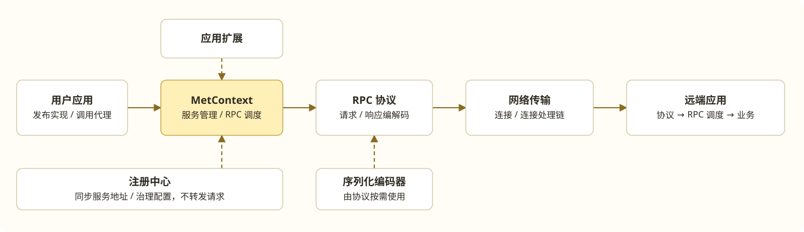
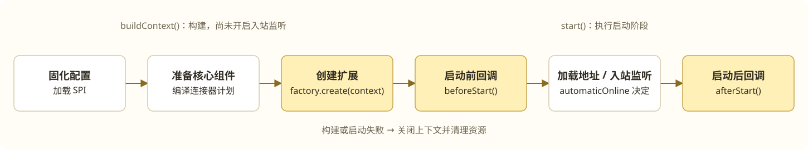
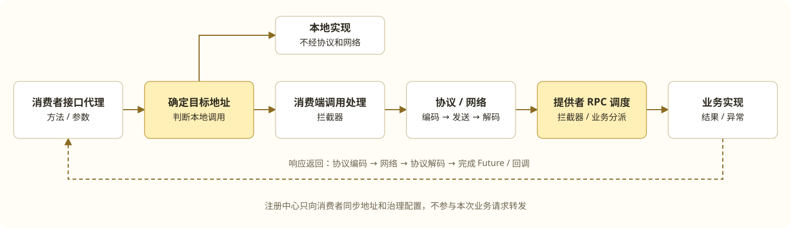

# 架构和工作流程

`MetContext` 管理服务、调用和扩展的运行资源。协议负责解释 RPC 消息，传输层负责建立连接和收发数据，注册中心负责服务发现和治理配置同步。

## 整体架构

- **应用层**：发布业务实现，或取得接口代理发起调用。
- **RPC 调度**：管理服务坐标、选择调用地址、执行拦截器、分派请求和完成调用结果。
- **协议层**：把 RPC 请求和结果转换为协议消息；是否使用可替换的序列化编码器，由协议决定。
- **传输层**：管理监听、连接和数据收发。HTTP、TCP、UDP 协议分别接入对应传输。
- **注册中心**：同步服务地址和治理配置，不转发业务请求。

应用扩展安装在上下文中；连接处理链位于传输内部。它们分别见[编写应用扩展](lifecycle.md)和[扩展连接处理链](pipeline.md)。

## 启动流程

`buildContext()` 固化配置，加载序列化、传输和协议 SPI，准备连接器，随后调用各扩展工厂的 `create(context)`。返回时上下文已构建，入站监听尚未开启。

`start()` 依次执行：

1. 扩展的 `beforeStart()`，准备启动所需资源。
2. 启动地址缓存、加载地址本，按 `automaticOnline` 决定是否开启入站监听。
3. 扩展的 `afterStart()`，再通知启动完成事件。

因此，默认自动上线时可在 `afterStart()` 读取实际监听地址；关闭自动上线时，不能把此回调视为已经监听。扩展创建或启动失败会触发清理，`close()` 必须能处理只初始化了一部分的状态。

上下文关闭时统一释放扩展和核心资源。扩展只关闭自己持有的资源，不关闭所属上下文或借用的共享资源。应用上下线见[优雅上下线](../services/lifecycle/online.md)。

## 调用流程

以普通请求响应为例：

1. 消费者调用接口代理，框架解析方法和参数，确定目标地址。
2. 若命中本地实现并允许本地调用，直接进入本地执行；否则执行消费端拦截器并提交远程请求。
3. 协议将请求转换为消息，经传输层发送给提供者。
4. 提供者解析消息，由 RPC 调度执行拦截器并调用业务实现。
5. 结果或异常经协议和网络返回，消费者完成同步等待、Future 或回调。

本地调用不经过网络和协议编解码，具体选择见[本地调用](../governance/local.md)。拦截器可提前返回结果，因此请求也可能在消费端结束。
