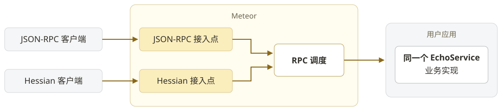

# 多协议发布

多协议发布让不同协议的客户端调用同一份服务实现，无需为每种协议重复编写业务代码。



## 发布方式

引入所需的协议模块，在应用启动时配置协议接入点：

```java
MetConfiguration config = new MetConfiguration();
var http = config.connector("http");
http.bind("127.0.0.1", 8080);
http.protocol("jsonrpc").contextPath("/jsonrpc");
http.protocol("hessian").contextPath("/hessian");
```

发布服务时不调用 `protocol(...)`，默认使用全部已配置的协议接入点；也可以显式指定，只为该服务启用选定的协议：

```java
context.publisher().rsfService(EchoService.class, new EchoServiceImpl())
        .protocol("jsonrpc", "hessian")
        .register();
```

各协议支持的参数类型、接口文件和客户端用法见[协议支持](../../protocols/about.md)。

## 配置概念

### [端口复用](ports.md)

决定多个协议共用一个监听端口，还是分别监听。上例中 JSON-RPC 和 Hessian 共用 `8080` 端口。

### [路径挂载](http-paths.md)

决定 HTTP 请求如何找到对应协议和服务。上例用 `/jsonrpc` 和 `/hessian` 区分协议，服务还可在协议前缀下设置自己的子路径。
